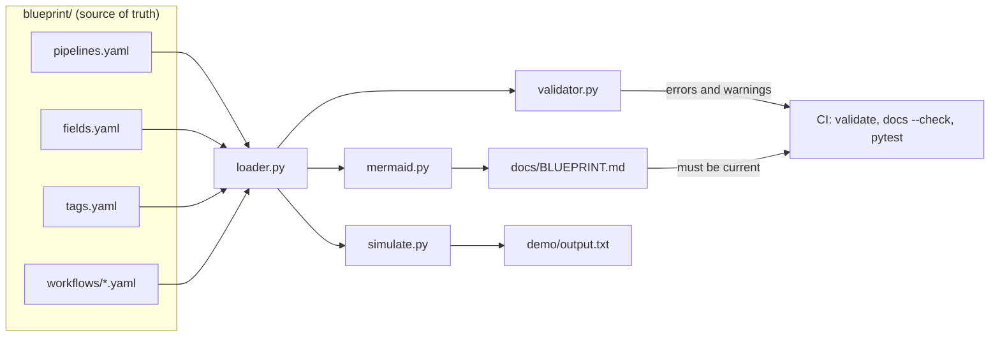

# ghl-home-services-blueprint

CRM automations for a home services company usually live only inside the CRM, where nobody can review, diff or test them.
One renamed stage or tag then quietly breaks a workflow, and the first sign is a lead that never got a text back.

This repo is a documented CRM blueprint in the style of GoHighLevel, written as plain YAML, with a validator that checks every reference, mermaid diagrams generated from the definitions, and an offline simulator.

**This is a documented design, not an official export format.** The YAML schema here is my own. It cannot be imported into GoHighLevel or any other CRM, and it is not affiliated with or endorsed by any vendor. You read it, validate it, and then build the workflows by hand in the CRM using it as the spec.

## What it does

- Defines two pipelines (Sales, Jobs) with 11 stages, 8 custom fields and 11 tags in `blueprint/`.
- Defines five workflows as structured YAML in `blueprint/workflows/`: new lead, missed call text back, estimate follow up, job complete, review ask.
- `validate` checks that every workflow references only stages, fields and tags that are defined. It also checks merge fields inside message text, dropdown values, wait durations, step links, loops, unreachable steps, and tags that trigger a workflow but that nothing ever adds.
- `docs` generates [docs/BLUEPRINT.md](docs/BLUEPRINT.md): one mermaid diagram per pipeline and per workflow, plus field and tag tables. CI fails if that file is stale.
- `simulate` dry runs a workflow against a synthetic contact and prints each step, with a virtual clock for waits. Nothing is sent anywhere.

## Architecture



The job complete workflow hands off to the review ask by adding the `review-eligible` tag, which is the review ask trigger. The validator checks that link too.

## Run it

Needs Python 3.10 or newer.

```
pip install -r requirements.txt
python -m blueprint_tools validate
python -m blueprint_tools docs
```

Other commands:

```
python -m blueprint_tools validate --strict     # warnings fail too
python -m blueprint_tools docs --check          # fail if docs/BLUEPRINT.md is stale
python -m blueprint_tools simulate demo/scenarios/new_lead_no_reply.yaml
```

## Tests

```
python -m pytest -q
```

36 tests: the shipped blueprint validates clean, each kind of broken reference is caught, the diagrams cover every step and branch, the committed docs match the definitions, and the simulator takes the expected path through each workflow (for example an unhappy customer never gets a review ask). CI runs the same in `.github/workflows/ci.yml`.

## Demo

```
python demo/run_demo.py
```

Runs offline with no keys. It validates the blueprint, then validates an in-memory copy with six realistic mistakes (a renamed stage, a tag that was never created, a merge field that does not exist, and so on), then dry runs all five workflows with synthetic contacts. Captured output is in [demo/output.txt](demo/output.txt). A sample of the broken copy check:

```
ERROR   estimate_follow_up:trigger: stage 'quote_sent' is not defined in pipeline 'sales'
ERROR   estimate_follow_up:tag_pending: tag 'estimate-open' is not defined in tags.yaml
ERROR   estimate_follow_up:sms_check_in: field 'quote_total' is not defined in fields.yaml
```

## The workflow format

```yaml
id: missed_call
trigger: {type: missed_call}
steps:
  - id: opted_out
    type: condition
    if: {has_tag: do-not-contact}
    then: done
    else: tag_missed
  - id: tag_missed
    type: add_tag
    tag: missed-call
  - id: done
    type: end
```

- Triggers: `form_submitted`, `missed_call`, `stage_entered`, `tag_added`.
- Steps: `add_tag`, `remove_tag`, `set_field`, `move_stage`, `send_sms`, `send_email`, `notify_team`, `create_task`, `wait`, `condition`, `end`.
- Conditions test one thing: `has_tag`, `in_stage`, `field` (with `equals` or `is_set`), or `replied`.
- A step runs into the next one in the list unless it sets `next`. Conditions always name `then` and `else`.
- Merge fields: `{{contact.first_name}}`, `{{custom.<field key>}}`, `{{business.name}}`, `{{today}}`.

## Where this pattern runs

This is drawn from systems that run two small service companies day to day. The live versions have more workflows and their own stage names, but the habit is the same: the automation design lives in version control as data, a script refuses any change that references something undefined, and the diagrams people look at are generated, never drawn by hand.

## Limitations

- It is a design document with tooling. There is no import, export or sync with any CRM. Building the workflows in the CRM is still manual, and nothing checks that the live CRM matches this repo.
- The schema covers a small set of triggers and step types. Real CRMs have many more (webhooks, appointment triggers, goal events, split tests) that are not modeled.
- Workflows must be acyclic. Repeat loops, re-entry rules and a contact being in several workflows at once are not modeled.
- The simulator walks one contact through one workflow. It does not chain workflows, model business hours or time zones, or check message length and compliance wording. Opt out handling is a tag check in the missed call and review ask workflows only; the other three assume a contact who just asked for service. Real consent rules need legal review.
- The validator checks references and structure, not whether the messages or timings are good.
- All contacts, phone numbers and the business in the demo are synthetic.

License: MIT, see the LICENSE file.
