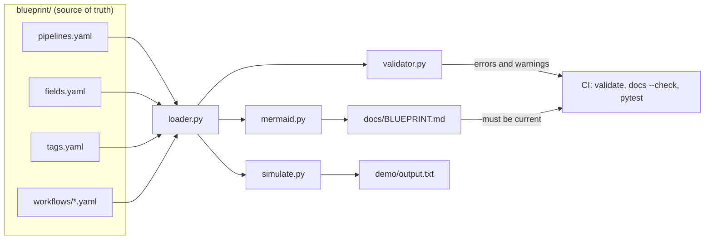

# ghl-home-services-blueprint

**The problem:** a home services company runs on a handful of CRM automations: text back a missed call, chase an open estimate, ask for a review. They live only inside the CRM, where nobody can review, diff or test them. Someone renames a stage or a tag, a workflow quietly stops matching, and the first sign is a lead who never got a text back.

**What this is:** the whole setup for a plumbing, HVAC, electrical or handyman shop written down as plain files you can read and check before anyone builds it in GoHighLevel (or a similar CRM):

- 2 pipelines (Sales, Jobs), 8 custom fields, 11 tags and 5 workflows: new lead, missed call text back, estimate follow up, job closeout, review ask.
- A checker that refuses the design if any workflow points at a stage, tag, field or step that does not exist.
- Flow diagrams generated from the same files, so the picture cannot drift from the spec: [docs/BLUEPRINT.md](docs/BLUEPRINT.md).
- An offline dry run that walks a made up contact through each workflow and prints every text, email, task and wait.

**What it is not:** it does not connect to GoHighLevel or any other CRM. Nothing here calls an API, sends a message or imports into an account. The YAML format is my own, not an official export format, and this project is not affiliated with or endorsed by any vendor. You validate the design here, then build the workflows by hand in the CRM using it as the spec.

## What you will see

`python demo/run_demo.py` runs offline with no keys. Real lines from its output (full capture in [demo/output.txt](demo/output.txt), and a test fails if these lines stop matching it):

```
Checked 5 workflows against 2 pipelines (11 stages), 8 fields, 11 tags: 0 errors, 0 warnings.
...
ERROR   estimate_follow_up:trigger: stage 'quote_sent' is not defined in pipeline 'sales'
ERROR   estimate_follow_up:tag_pending: tag 'estimate-open' is not defined in tags.yaml
ERROR   estimate_follow_up:sms_check_in: field 'quote_total' is not defined in fields.yaml
...
Scenario: Missed call from a new caller who texts back
  [day 0 00:00] opted_out            Opted out? no
  [day 0 00:00] tag_missed           add tag missed-call
  [day 0 00:00] text_back            SMS to 555-0102: Sorry we missed your call. This is Sample Home Services. What can we help with? Reply here and we will get right back to you.
  [day 0 00:00] open_opportunity     move to sales.new_lead
  [day 0 00:00] wait_for_reply       wait 30m
  [day 0 00:30] (meanwhile)          contact replied
  [day 0 00:30] clear_missed         remove tag missed-call
```

The first line is the shipped design passing. The `ERROR` lines are the checker catching a copy with six deliberate mistakes (a renamed stage, a tag that was never created, a merge field that does not exist, and so on). The rest is a dry run: the "SMS" is a printed line, the clock is virtual, and the contact is fake.

## What each command does

- `validate` checks that every workflow references only stages, fields and tags that are defined. It also checks merge fields inside message text, dropdown values, wait durations, step links, loops, unreachable steps, and tags that trigger a workflow but that nothing ever adds.
- `docs` generates [docs/BLUEPRINT.md](docs/BLUEPRINT.md): one mermaid diagram per pipeline and per workflow, plus field and tag tables. CI fails if that file is stale.
- `simulate` dry runs one workflow against a synthetic contact from a scenario file and prints each step, with a virtual clock for waits. A scenario can say what happens during a wait (the customer replies, staff move the deal to Won).

## Architecture



The job complete workflow hands off to the review ask by adding the `review-eligible` tag, which is the review ask trigger. The validator checks that link too.

## Run it

Tested on Python 3.12 (the version CI uses). The only dependencies are PyYAML and pytest.

```
python -m venv .venv
source .venv/bin/activate      # Windows: .venv\Scripts\activate
pip install -r requirements.txt
python -m blueprint_tools validate
python -m blueprint_tools docs
```

Other commands:

```
python -m blueprint_tools validate --strict     # warnings fail too
python -m blueprint_tools docs --check          # fail if docs/BLUEPRINT.md is stale
python -m blueprint_tools simulate demo/scenarios/new_lead_no_reply.yaml
```

## Tests

```
python -m pytest -q
```

45 tests: the shipped blueprint validates clean, each kind of broken reference is caught, the diagrams cover every step and branch, the committed docs and demo output match the code, and the simulator takes the expected path through each workflow (for example an unhappy or neutral customer never gets a review ask). CI runs validate, the docs check and the tests on every push in `.github/workflows/ci.yml`.

## Demo

```
python demo/run_demo.py
```

It validates the blueprint, then validates an in-memory copy with six deliberate mistakes, then dry runs all five workflows with synthetic contacts, then checks the generated docs are current. Captured output is in [demo/output.txt](demo/output.txt).

## The workflow format

```yaml
id: missed_call
trigger: {type: missed_call}
steps:
  - id: opted_out
    type: condition
    if: {has_tag: do-not-contact}
    then: done
    else: tag_missed
  - id: tag_missed
    type: add_tag
    tag: missed-call
  - id: done
    type: end
```

- Triggers: `form_submitted`, `missed_call`, `stage_entered`, `tag_added`.
- Steps: `add_tag`, `remove_tag`, `set_field`, `move_stage`, `send_sms`, `send_email`, `notify_team`, `create_task`, `wait`, `condition`, `end`.
- Conditions test one thing: `has_tag`, `in_stage`, `field` (with `equals` or `is_set`), or `replied`.
- A step runs into the next one in the list unless it sets `next`. Conditions always name `then` and `else`.
- Merge fields: `{{contact.first_name}}`, `{{custom.<field key>}}`, `{{business.name}}`, `{{today}}`.

## Where this pattern comes from

This is drawn from systems that run two small service companies day to day. The live versions have more workflows and their own stage names, and none of that is in this repo, so you cannot verify it from here. What is here is the habit: the automation design lives in version control as data, a script refuses any change that references something undefined, and the diagrams people look at are generated, never drawn by hand. No results or client numbers are claimed.

## Limitations

- **No CRM connection at all.** There is no import, export, sync or API client, not even a mocked one. This code has never been run against a GoHighLevel account or any other live service. Building the workflows in the CRM is manual, and nothing checks that the live CRM matches this repo.
- **The format is mine.** Trigger and step names are my own shorthand for common CRM features. They have not been checked one for one against the current GoHighLevel workflow builder, so expect to translate when you build.
- **Small vocabulary.** Four triggers and eleven step types. Webhooks, appointment triggers, goal events, split tests, payments and AI steps are not modeled.
- **Timings are intentions, not measurements.** "Wait 30m" or "text back as the first step" describes the design. How fast a real CRM sends is not tested here.
- **The simulator is a walkthrough, not an emulator.** One contact, one workflow, a virtual clock. It does not chain workflows (job closeout adds the tag that starts the review ask, but the demo runs them separately), model business hours or time zones, re-entry, or a contact in several workflows at once. Workflows must be acyclic.
- **Opt out is only partly designed.** The `do-not-contact` tag is checked in the missed call and review ask workflows only. New lead, estimate follow up and job closeout send without checking it and would rely on the CRM's own do not disturb setting. Message wording, consent and sending hours have had no legal or carrier compliance review.
- **Empty fields are not caught.** The checker proves a merge field exists, not that it has a value when the message goes out. For example the closeout text names the assigned tech, and nothing guarantees that field was filled in.
- **It checks structure, not quality.** Nothing here says whether the messages or timings are good, and there are no conversion or response numbers because none were measured.
- All contacts, phone numbers and the business in the demo are synthetic.

License: MIT, see the LICENSE file.
