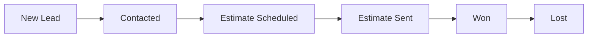
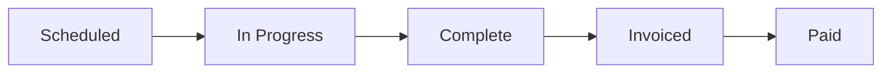
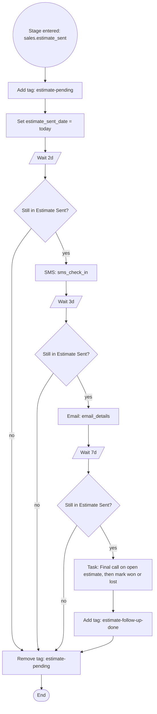
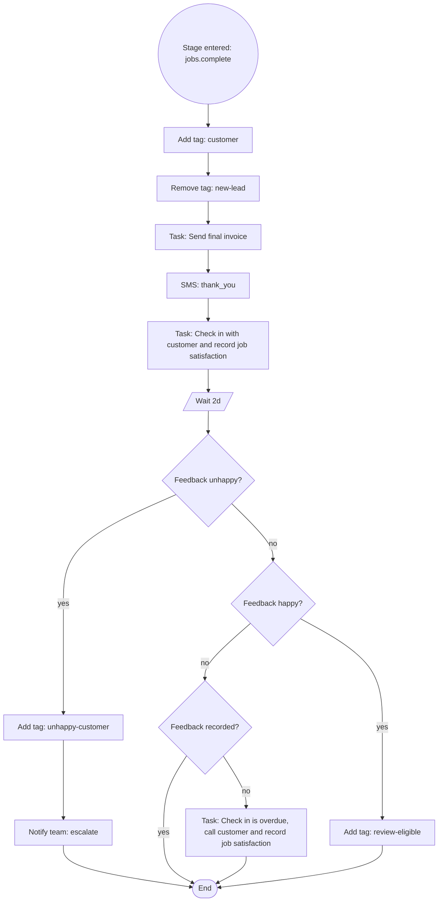
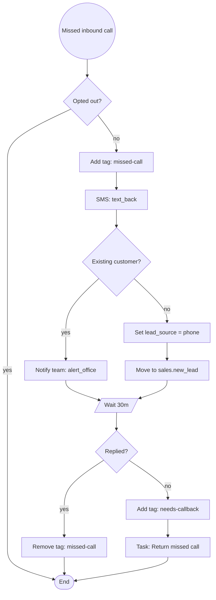
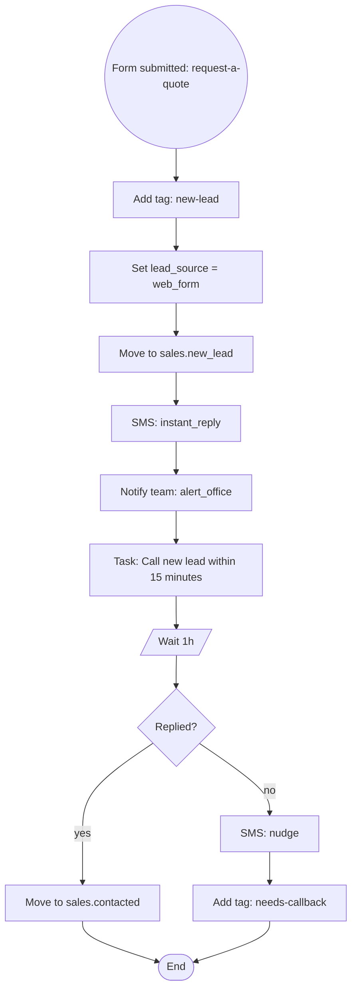
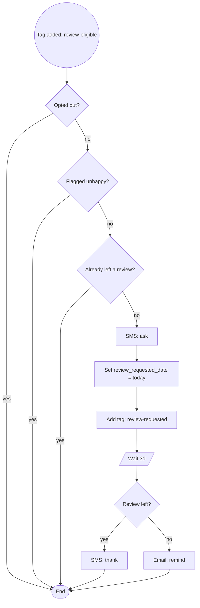

# Home Services CRM Blueprint

Generated by `python -m blueprint_tools docs` from the files in `blueprint/`.
Do not edit by hand. This is a documented design in the style of GoHighLevel,
not an official export or import format.

## Pipelines

### Sales (`sales`)

From first contact to a signed or declined estimate.

### Jobs (`jobs`)

Production pipeline for accepted work.

## Custom fields

| Key | Name | Type | Options |
| --- | --- | --- | --- |
| `service_type` | Service Type | dropdown | plumbing, electrical, hvac, handyman, remodel |
| `lead_source` | Lead Source | dropdown | web_form, phone, referral, ad |
| `estimate_amount` | Estimate Amount | number |  |
| `estimate_sent_date` | Estimate Sent Date | date |  |
| `preferred_contact_window` | Preferred Contact Window | dropdown | morning, afternoon, evening |
| `job_satisfaction` | Job Satisfaction | dropdown | happy, neutral, unhappy |
| `review_requested_date` | Review Requested Date | date |  |
| `assigned_tech` | Assigned Tech | text |  |

## Tags

| Tag | Purpose |
| --- | --- |
| `new-lead` | Contact entered through an intake path and has not been qualified. |
| `missed-call` | We missed an inbound call and the text back is in flight. |
| `needs-callback` | A person must call this contact. Drives the daily callback list. |
| `estimate-pending` | An estimate is out and the follow up sequence is active. |
| `estimate-follow-up-done` | The follow up sequence ran to the end with no decision. |
| `customer` | At least one job has been completed for this contact. |
| `unhappy-customer` | Job feedback was negative. Blocks the review ask. |
| `review-eligible` | Job closed out cleanly. Adding it starts the review ask. |
| `review-requested` | A review request has been sent. |
| `review-left` | Staff confirmed a public review was posted. |
| `do-not-contact` | Contact opted out. Missed call and review ask check it before sending. |

## Workflows

### Estimate Follow Up (`estimate_follow_up`)

Goal: Follow up on a sent estimate three times, and stop the moment the deal moves.

Source: `blueprint/workflows/estimate_follow_up.yaml`

### Job Complete Closeout (`job_complete`)

Goal: Close out a finished job, catch unhappy customers early, and hand only happy ones to the review ask.

Source: `blueprint/workflows/job_complete.yaml`

### Missed Call Text Back (`missed_call`)

Goal: Turn a missed call into a text conversation before the caller dials a competitor.

Source: `blueprint/workflows/missed_call.yaml`

### New Lead Intake (`new_lead`)

Goal: Text a web lead back as the first step and make sure a person follows up.

Source: `blueprint/workflows/new_lead.yaml`

### Review Ask (`review_ask`)

Goal: Ask happy customers for a review once, remind once, and never ask an unhappy one.

Source: `blueprint/workflows/review_ask.yaml`

